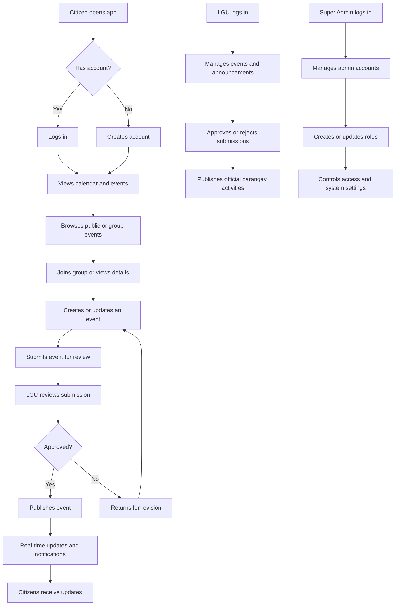

# Barangay Events Promo Package

## 1. Workflow Summary

Barangay Events is a Flutter-based mobile app that helps citizens, LGU staff, and administrators coordinate community activities in one place. Citizens can sign up, view the calendar, join groups, and submit or follow events. LGU staff review and publish official barangay activities, while super admins manage access and account roles. The system uses real-time updates and push notifications to keep everyone informed.

## 2. Main Process Flowchart

## 3. 50-Second Promo Script

Hello everyone, meet Barangay Events, a smart digital platform for connecting communities. Citizens can sign up, view upcoming activities, join groups, and share events with ease. LGU staff can review submissions, manage official barangay activities, and keep the calendar organized. Super admins oversee roles and access, ensuring the system stays secure and well managed. With real-time updates and notifications, Barangay Events makes communication faster, clearer, and more community-driven.

## 4. Concise Feature-Focused Video Script

    Barangay Events is a digital platform that brings the community together in one simple app. Citizens can discover local activities, join groups, and stay updated on events that matter to them. LGU staff can review submissions, approve official activities, and share trusted information with the public. Super admins manage access and roles to keep the system secure and organized. With real-time updates and notifications, Barangay Events helps everyone communicate faster and stay connected.

## 4A. 30-Second Motion Graphics Script

Barangay Events.

Connect. Coordinate. Celebrate.

Citizens discover local events.

LGU staff review and publish updates.

Super admins manage access and roles.

Real-time notifications keep everyone informed.

One app for the whole barangay.

## 4B. Clip / Visual Inputs

1. Opening title card with the app name and a quick calendar or map animation.
2. Citizens scrolling events, tapping cards, and joining community activities.
3. LGU dashboard or review screen showing event approval or publishing.
4. Admin screen showing role management, access control, or settings.
5. Notification pop-ups or live update animation.
6. Closing end card with the line “Connect. Coordinate. Celebrate.”

## 5. Scene-by-Scene Video Structure

1. Opening scene: show a lively barangay setting and transition into the app.
2. Scene 2: show citizens browsing events and joining groups.
3. Scene 3: show event submission and approval flow.
4. Scene 4: show LGU managing official activities.
5. Scene 5: show super admin overseeing roles and access.
6. Closing scene: show notifications and the message “Connect. Coordinate. Celebrate.”

## 6. Motion Graphics Ideas

- Open with a clean map or calendar animation transitioning into the app interface.
- Show cards or tiles for citizen, LGU, and super admin roles appearing one by one.
- Animate event creation and approval steps as flowing arrows.
- Use glowing icons for notifications, updates, and group participation.
- End with a bold title card: “Barangay Events — Connect. Coordinate. Celebrate.”

## 7. ElevenLabs Voiceover Script

This version is written for more natural speech pacing:

"Welcome to Barangay Events, a modern platform that helps communities stay connected. Citizens can explore events, join groups, and keep up with local activities in just a few taps. LGU staff can review submissions and publish official barangay updates with ease. Super admins manage roles and access to keep the system secure. With real-time notifications, Barangay Events makes communication simple, fast, and community-focused."

## 8. Short On-Screen Text Ideas

- Connect the community
- Share events faster
- Manage local activities
- Stay informed in real time
- Built for barangays, by design
