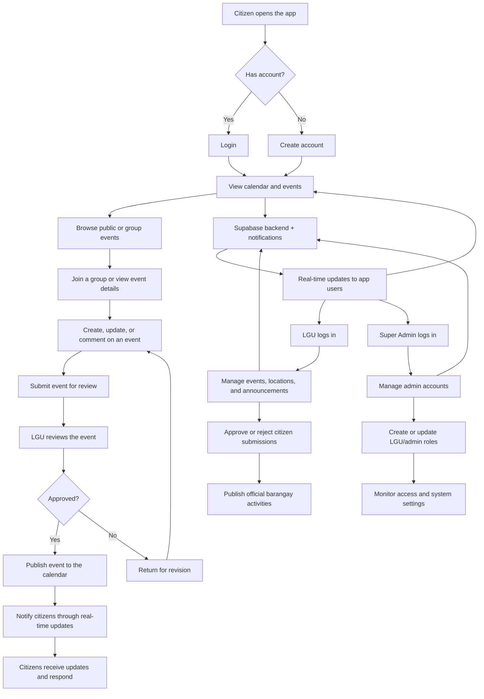

# Barangay Events System Flowchart

This document provides a clear Mermaid flowchart for the main process of the Barangay Events system, including the roles of citizen, LGU, and super admin.

## Main Process Flow

## Role Summary

- Citizen: opens the app, views events, joins groups, submits events, and receives updates.
- LGU: reviews submissions, manages official events, locations, and announcements.
- Super Admin: manages user roles, admin accounts, and overall system access.

## Suggested Presentation Note

This flow shows how the app connects everyday citizens, LGU staff, and administrators through one shared system for coordination, approval, and communication.
